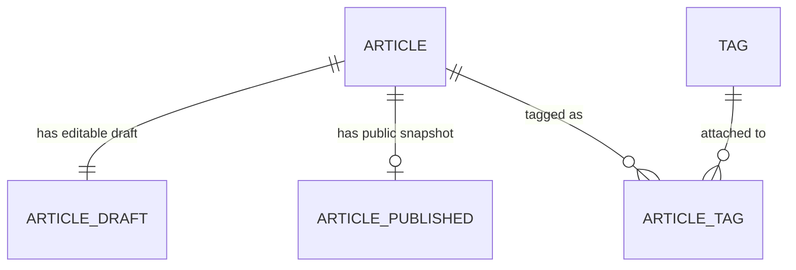
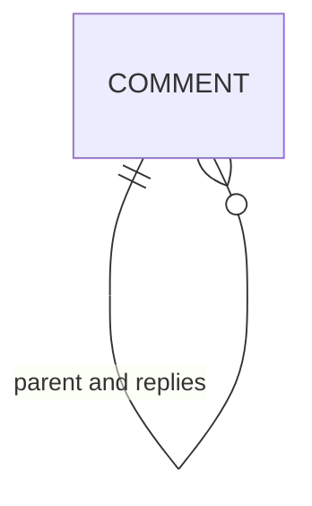
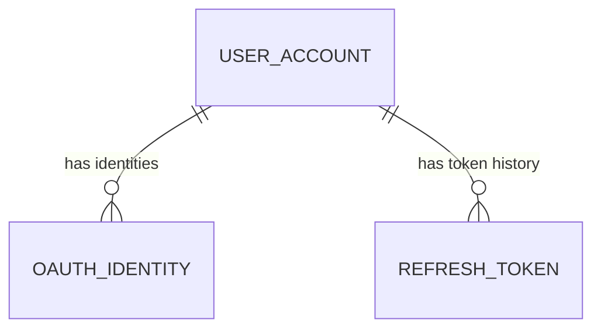

# 논리 ERD

> 상태: 구현 전 논리 설계 초안 · 기준: `docs/design/plan-and-design.md`, `docs/api/openapi.yaml`, ADR 0002 · 2026-11-03

이 다이어그램은 도메인 관계를 설명한다. 테이블 이름과 관계를 확정된 물리 구조로 간주하지 않는다. 현재 저장소에는 네 개 스키마를 만드는 초기화 SQL만 있으며, 컨텍스트 테이블을 생성하는 Flyway 마이그레이션은 아직 없다.

## 글과 태그 (`blog_article`)

- `ARTICLE`은 상태와 낙관적 잠금 버전을 가진다.
- `ARTICLE_DRAFT`는 현재 편집본이고 `ARTICLE_PUBLISHED`는 마지막 발행본이다. 발행 전에는 발행본이 없다.
- `ARTICLE_TAG`는 글과 태그의 연결이다. 태그 목록 순서가 제품 계약에 포함되지 않아 순서 컬럼은 아직 정하지 않았다.
- 공개 요약은 OpenAPI 설명대로 발행 Markdown에서 HTML/문법을 걷고 앞 160자를 계산하는 파생 값으로 둔다. 저장 컬럼 여부는 정하지 않았다.

## 댓글 (`blog_comment`)

- 한 댓글은 `parent_id`로 최상위 댓글을 가리킬 수 있다. 깊이는 최상위 댓글과 한 단계 답글로 제한한다.
- `article_id`와 `author_id`는 각각 글·사용자 ID를 값으로 보유한다. 서로 다른 스키마 사이에는 외래 키를 만들지 않는다.
- 댓글 숨김 상태는 OpenAPI 설명과 enum이 일치하지 않으므로 확정 모델에 포함하지 않았다.

## 사용자 인증 (`blog_auth`)

- 사용자는 Google OAuth 식별자와 애플리케이션 역할을 가진다.
- refresh token 회전·재사용 탐지를 위해 소비된 토큰의 식별 정보를 유지해야 한다. 저장 방식과 만료 정책은 구현 전 결정한다.
- `COMMENT.author_id` 및 `MEDIA.created_by`에서 참조하는 사용자 ID는 값 참조이며, 스키마 간 FK가 아니다.

## 미디어 (`blog_media`)

미디어 레코드는 독립 컨텍스트다. API는 업로드 URL 발급 후 `PENDING`에서 객체 확인을 거쳐 `CONFIRMED`로 전환하며 `mediaId`, `publicUrl`, `status`를 반환한다. 저장소 공급자와 객체 키 표현은 아직 확정되지 않았다.

## 컨텍스트 간 ID 참조

| 보유 컨텍스트  | 값 필드             | 대상                        | 정합성 확인 경계                   |
| -------------- | ------------------- | --------------------------- | ---------------------------------- |
| `blog_comment` | `article_id`        | `blog_article.ARTICLE.id`   | 댓글 유스케이스가 공개 글인지 확인 |
| `blog_comment` | `author_id`         | `blog_auth.USER_ACCOUNT.id` | 인증 주체 및 Auth ACL              |
| `blog_media`   | `created_by` (제안) | `blog_auth.USER_ACCOUNT.id` | 관리자 인증 경계                   |

이 참조에는 DB FK를 추가하지 않는다. 도메인 간 조회·검증은 설계된 ACL/유스케이스로 처리한다. `created_by`는 감사 필요성 및 보존 정책을 확인한 뒤 결정한다.

## API 모델과의 대응

| API 모델                          | 논리 데이터                                                       |
| --------------------------------- | ----------------------------------------------------------------- |
| `ArticleSummary`, `ArticleDetail` | `ARTICLE`, `ARTICLE_PUBLISHED`, `ARTICLE_TAG`, `TAG` 조회 결과    |
| `AdminArticle`                    | `ARTICLE`, `ARTICLE_DRAFT`, 선택적 `ARTICLE_PUBLISHED`, 태그 연결 |
| `Comment`                         | `COMMENT` 계층과 Auth ACL에서 조회한 공개 작성자 정보             |
| `Me`, `Author`                    | `USER_ACCOUNT`의 역할에 맞춘 공개 필드                            |
| `Media`                           | `MEDIA` 상태와 공개 URL                                           |

API 필드와 관계의 정본은 `docs/api/openapi.yaml`이다. 이 대응 표는 JSON 응답 형태가 DB 컬럼 구성이 같다는 의미가 아니다.
