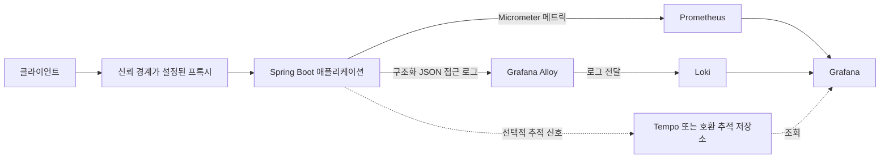

# 접근 정보 수집 및 관측성 설계

> 상태: 설계 제안. Prometheus Registry, 로그 수집기, Loki, Grafana, 추가 계측 코드는 아직 저장소에 구성되어 있지 않다. 구현할 때 이 문서를 코드·배포 설정과 함께 갱신한다.

## 목적과 범위

Java 21·Spring Boot 백엔드에서 API 성능과 오류를 모니터링하고, 필요한 경우 누가 어떤 경로로 접근했는지 운영 로그에서 조사할 수 있도록 한다. Prometheus 같은 메트릭 서버만으로 인증 객체나 IP별 요청 이력을 자동 수집하지 않는다. 요청별 식별 정보는 로그에 별도 계측해야 한다.

이 설계는 관측성 데이터의 수집·전달·조회 경로를 다룬다. 블로그 도메인의 API 계약이나 MySQL 업무 스키마는 변경하지 않는다. 로그를 향후 DB에 영속하는 요구가 생기면 그때 별도 개인정보·보존 요구와 함께 ERD 및 스키마를 검토한다.

## 현재 저장소 상태

- `monolith-main`에는 Spring Boot Actuator 스타터가 포함되어 있다.
- `application.yml`은 현재 `health` 엔드포인트만 웹에 노출한다.
- Prometheus Registry, JSON 접근 로그, Grafana Alloy, Prometheus, Loki, Grafana 설정은 아직 없다.
- 따라서 아래 구성과 필드 목록은 목표 설계이며 배포 사실이 아니다.

## 정보별 수집 위치

| 정보 | 수집 위치 | 설계 기준 |
| --- | --- | --- |
| 요청 수, 처리 시간, 응답 상태 | Prometheus 메트릭 | Micrometer HTTP 서버 계측을 기반으로 한다. |
| 정규화된 경로 템플릿, HTTP Method, 상태 분류 | Prometheus 메트릭 | `GET`, `/api/v1/articles/{articleId}`, 상태 코드처럼 유한한 값만 라벨로 사용한다. |
| 클라이언트 IP | 구조화 접근 로그 | 보안 조사 목적에 한해 최소 수집한다. 프록시 구성이 확인되기 전에는 전달 헤더를 신뢰하지 않는다. |
| 인증 여부·방식·사용자 식별 정보 | 구조화 보안/접근 로그 | 업무상 필요성을 확인하고 접근권한과 보존기간을 정한다. 전체 인증 객체는 저장하지 않는다. |
| 요청 ID 및 선택적 trace ID | 로그와 메트릭 외부 상관관계 | 기존 `X-Request-Id` 정책과 연결한다. 요청마다 다른 ID를 메트릭 라벨로 넣지 않는다. |
| 요청·응답 본문 및 민감한 헤더 | 수집하지 않음 | Authorization, 쿠키, 비밀번호, 토큰, 원문 JWT와 전체 principal 객체를 기록하지 않는다. |

요청별 상세 정보는 메트릭이 아니라 로그에서 조회한다. Prometheus 라벨은 각 라벨 조합마다 시계열을 늘리므로 사용자 ID, 이메일, IP, request ID, 원본 URI처럼 값이 계속 늘어나는 필드를 라벨에 넣지 않는다. URI는 숫자 ID나 임의 문자열이 포함된 원시 경로 대신 라우트 템플릿을 사용한다.

## 목표 구성과 데이터 흐름

- **메트릭:** Spring Boot Actuator와 Micrometer 계측을 Prometheus가 내부 네트워크에서 스크랩한다. Prometheus 스크랩용 엔드포인트는 공개 트래픽에 노출하지 않는다.
- **로그:** 애플리케이션이 구조화된 JSON 로그를 출력하고 Grafana Alloy가 수집해 Loki로 전달한다. Promtail은 2026년 3월 2일 지원이 종료되어 새 구성의 수집기 후보에서 제외한다.
- **대시보드:** Grafana에서 요청량·지연·오류 메트릭과 선택한 시간대의 접근 로그를 함께 조회한다.
- **추적:** 여러 서비스로 확장되거나 분산 요청 진단이 필요할 때 Micrometer Tracing과 Tempo 계열 저장소를 별도 검토한다. 현재 모놀리스 MVP의 필수 구성은 아니다.

## 계측 기준

### 메트릭

기본 HTTP 요청 관측에서 다음을 제공한다.

- 요청 수 및 초당 요청량
- 응답 지연 분포와 평균 응답 시간
- HTTP 상태 코드, 성공/클라이언트 오류/서버 오류 분류
- JVM 및 애플리케이션 상태 지표

Spring MVC의 기본 HTTP 요청 메트릭 이름은 `http.server.requests`다. 기본 태그는 설치 버전과 웹 스택을 기준으로 확인하며, method, URI 템플릿, status, outcome, exception 등이 사용될 수 있다. 처리된 예외가 항상 태그로 기록되는 것은 아니므로 필요한 오류 신호는 실제 계측 동작을 확인한다.

기본 계측만으로 부족한 사용자 정의 태그가 생기면 제한된 값인지 먼저 확인하고 `ServerRequestObservationConvention` 등 설치된 Spring Boot 버전이 지원하는 관측 확장 지점을 검토한다. 고유 사용자, IP, 토큰, 요청 ID는 절대 메트릭 태그로 추가하지 않는다.

Prometheus 스크랩 엔드포인트를 활성화하려면 Prometheus Registry 의존성과 `prometheus` 엔드포인트 노출을 별도 변경으로 추가한다. 이 저장소의 버전 카탈로그 규칙을 따라 의존성을 관리하고, 엔드포인트 접근 경로·네트워크 제한·인증을 함께 설계한다. 기본 설정을 그대로 공개망에 노출하지 않는다.

### 구조화 접근 로그

로그 이벤트는 한 요청을 한 줄의 JSON으로 표현한다. 초기 후보 필드는 다음과 같다.

| 필드 | 설명 |
| --- | --- |
| `timestamp` | UTC 이벤트 시각 |
| `level` | 로그 수준 |
| `service`, `environment` | 서비스와 배포 환경 |
| `request_id` | 요청 상관관계 ID |
| `method`, `route` | HTTP Method 및 정규화된 라우트 템플릿 |
| `status`, `duration_ms` | 응답 상태와 처리 시간 |
| `client_ip` | 정책 승인 시에만 기록하는 클라이언트 주소 |
| `authenticated`, `auth_type` | 인증 여부 및 제한된 인증 방식 분류 |
| `principal_id` | 필요성이 승인된 경우에만 최소 식별자로 기록 |

구체적인 로그 발생 지점은 Spring Security 인증 성공·실패 경로와 요청 완료 지점을 확인한 뒤 결정한다. 실패한 인증은 SecurityContext가 비어 있을 수 있으므로, 존재하지 않는 인증 객체를 가정하지 않는다. 실제 클라이언트 주소는 신뢰 프록시와 헤더 전달 정책을 확정한 후에만 해석한다.

다음 값은 로그에 기록하지 않는다.

- Authorization, Cookie, Set-Cookie 헤더와 access/refresh token, 원문 JWT
- 비밀번호, 인증 객체 전체, 요청·응답 본문 전체
- 쿼리 문자열 전체. URL에 민감 값이 포함될 가능성을 배제할 수 없기 때문이다.
- 로그 목적에 필요하지 않은 이메일, 이름, 기타 직접 식별 정보

사용자 식별자나 IP를 기록하려면 접근권한, 마스킹·가명화 여부, 보존기간, 삭제 절차를 먼저 정한다. 이 정책은 현재 미결 사항이며 실제 운영에 적용하기 전 개인정보 검토가 필요하다.

## 대시보드와 탐지 예시

첫 대시보드는 전체 요청량, 인증 실패 수, HTTP 5xx 수, 응답 지연을 시간대별로 보여준다. 숫자는 실제 운영값이 아니라 화면 구성 항목이다.

다음 탐지 규칙을 후보로 둔다. 임계값과 알림 수신 경로는 기준 트래픽과 운영시간을 측정한 뒤 정한다.

| 탐지 후보 | 신호 |
| --- | --- |
| 인증 공격 의심 | 짧은 시간 동안 인증 실패가 급증하고, 로그에서 동일 IP 또는 계정의 반복을 확인 |
| 비정상 API 접근 | 인증되지 않은 접근 또는 401·403 응답이 급증 |
| API 남용 의심 | 특정 출처에서 요청량이 급증하거나 429가 증가 |
| 서버 오류 | 5xx 비율이 기준치를 넘거나 특정 라우트의 오류가 지속 |
| 성능 저하 | 요청 지연 분포가 서비스 목표를 넘는 상태가 지속 |

IP와 사용자별 집계는 Loki 등의 로그 조회에서 수행하고 Prometheus 라벨 조합으로 만들지 않는다.

## 구현 순서

1. 배포 환경, 프록시 체인, 로그 접근권한, 보존기간, 익명화 정책을 확정한다.
2. Prometheus Registry를 추가하고 내부 스크랩 전용으로 Actuator Prometheus 엔드포인트를 노출한다.
3. 민감 필드를 제외한 JSON 접근 로그와 요청 ID 상관관계를 구현한다.
4. Grafana Alloy와 Loki 전달 설정을 배포 환경에 추가하고 접근권한·보존 설정을 검토한다.
5. 대시보드와 알림 임계값을 실제 트래픽에 맞춰 구성한다.
6. 분산 추적 요구가 생기면 tracing exporter와 저장소를 별도 결정한다.

각 구현 단계에서 이 문서와 의존성, Spring 설정, 로깅 설정, 인프라 매니페스트를 함께 갱신한다. 새로운 업무 테이블이 없으면 ERD와 스키마 정의서는 변경하지 않는다.

## 결정이 필요한 항목

- 배포 환경과 Prometheus·Loki·Grafana의 설치 위치 및 운영 주체
- Actuator 엔드포인트의 네트워크 경계와 인증 방법
- 클라이언트 IP 및 principal 식별 정보의 수집 필요성, 마스킹, 접근권한, 보존기간
- JSON 로그 라이브러리와 로그 전달 방식
- 인증 성공·실패 이벤트를 기록할 Spring Security 확장 지점
- 알림 임계값, 온콜 대상, 실제 추적 시스템 도입 필요성

## 참고 자료

- [Spring Boot Actuator Metrics](https://docs.spring.io/spring-boot/reference/actuator/metrics.html)
- [Spring Boot Actuator Endpoints](https://docs.spring.io/spring-boot/reference/actuator/endpoints.html)
- [Prometheus metric and label naming](https://prometheus.io/docs/practices/naming/)
- [Grafana Alloy로 Promtail 마이그레이션](https://grafana.com/docs/grafana-cloud/send-data/alloy/set-up/migrate/from-promtail/)
